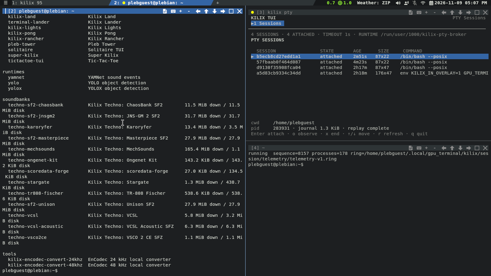
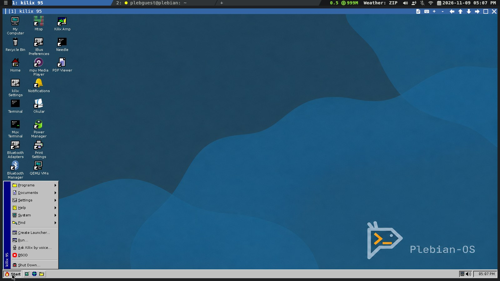

# Kilix

Kilix is a Tilix-styled terminal built on a fork of kitty, with pages, splits,
clickable pane title-bar buttons and a status bar, plus the host commands,
application catalog and desktop providers behind the Plebian-OS desktop.

**Status:** ships in Plebian-OS, where it is the whole desktop session.
Plebian-OS 0.2.2 shipped the Kilix `v0.2.2` tag; the 0.2.3 release candidate
(plebian-os tag `v0.2.3-rc6`) pins Kilix `beb39587` in `releases/0.2.3.env`,
which this branch contains. Kilix also runs standalone on a Linux X11 or Wayland
desktop, and as a native Windows preview ([windows/README.md](windows/README.md)).



## What it does

- **Clickable pane chrome:** a CPU/RAM chip, synchronized-input keyboard,
  `+`/`-` text size, four split arrows, maximize and close on every pane title
  bar; the title opens a pane menu, and dragging it onto another pane splits it.
- **Pages and a status bar:** kitty tabs in a page strip with a `+` button, an
  optional Start menu, and clickable status items (system load, GPU,
  thermometer, volume, network, weather, voice, date/time, battery).
- **Crash-persistent panes:** each pane's shell runs behind its own
  `kitty-pty-broker`, so a frontend crash only detaches it; `kilix pty`
  manages these sessions.
- **Session logs:** every pane's output is kept in a bounded private log that
  `kilix transcript` replays as readable text.
- **Scriptable control:** `kilix pane`, `kilix new-tab`, `kilix ls`,
  `kilix focus` and `kilix watch` act on the running instance; `F12` opens the
  Pane Center.
- **Applications in panes:** `kilix run` for X11 applications, `kilix open-url`
  for browsers, `kilix image` and `kilix video` for media.
- **Desktops in a tab:** Kilix 95 by default (`kilix desktop`), and the optional
  Kilix Cap, Kilix TUI, Kilix Land and Kilix IceWM providers.
- **One install list:** `kilix install` and `kilix app run ID` for the pinned
  catalog's applications, games and runtimes; `kilix models` and
  `kilix wizard` for licence-gated local models.
- **Speech, requests and help:** read-aloud and dictation buttons, `kilix ask`
  for plain-language requests, `kilix help-search` over the bundled docs.
- **Streaming:** share a text session, a live pane, a GUI application or the
  whole Kilix with another device; every tier binds to loopback by default.
- **Self-contained:** its own engine, config and window class leave an
  installed kitty alone; writable files live under `~/.local/gpu_terminal/kilix`.

`kilix session` launches managed Codex, Claude or Grok runs with explicit folder
trust, native UI or headless logging, and lifecycle inspection. New panes preserve
focus. See [managed coding sessions](docs/session.md) for commands, the importable
`kilix_session` library and the installed `kilix-session` entry.



## Quick start

```bash
mkdir -p ~/.local/gpu_terminal/sources
git clone --recursive https://github.com/itsmygithubacct/kilix.git ~/.local/gpu_terminal/sources/kilix
~/.local/gpu_terminal/sources/kilix/kilix
```

The first run tries to build the kitty fork in `src/`. If that fails it runs
`bootstrap.sh`, which installs a prebuilt kitty without the pane buttons, and
only with a pinned version and SHA-256 (`KILIX_PREBUILT_VERSION`,
`KILIX_PREBUILT_SHA256`) or explicit `--allow-unverified` consent. To install
the build dependencies and build the fork:

```bash
~/.local/gpu_terminal/sources/kilix/scripts/install-build-deps.sh   # Go + X11 dev libs + Python/Pillow
~/.local/gpu_terminal/sources/kilix/kilix --build                    # compile the clickable-chrome fork
```

The build needs Go 1.26 or newer (`build.sh` pins the toolchain named in
`src/go.mod`), Python 3.12 or newer with headers, a C compiler and kitty's X11
and Wayland development packages; the script supports dnf, apt, pacman and
zypper. `kilix --install-desktop` adds a menu entry and taskbar icon.
Requirements, engines and the full first-run command list are in
[docs/install.md](docs/install.md).

### Optional coding-agent skills

Kilix ships five separate skills as one versioned bundle: `kilix`,
`kilix-model-switch`, `kilix-session-launch`, `kilix-desktop`, and `kilix-pty`. They cover pane/session
administration, changing a model within an existing coding session, and
creating a tab of initialized coding sessions. Installation is explicit:

```bash
kilix skills list --json
kilix skills status --agent codex
kilix skills install --agent codex
kilix skills install --agent claude
kilix skills install --agent kimi
kilix skills remove --agent codex

# Alternatively, opt in after a successful vendor install or update:
kilix install codex --skills
kilix install --update codex --skills
```

Both mutation commands require `--agent codex|claude|kimi`; `list` and `status`
also accept `--json`. `status` without `--agent` reports each agent separately.
An ordinary agent install, vendor update, or `kilix update` does not register
or refresh these skills. Repeat the explicit skill install after updating the
Kilix source to adopt its new bundle. Bundle identity includes `VERSION` and
every instruction/support file's name, bytes and executable status. A failed
skill setup reports failure while leaving a successful vendor installation intact.

| Agent | Current user discovery root | Custom-root behavior |
|---|---|---|
| Codex | `$HOME/.agents/skills` | `CODEX_HOME` does not redirect this shared root; an existing same-name skill under its `skills` directory is a conflict. |
| Claude Code | `$HOME/.claude/skills` | An explicit absolute `CLAUDE_CONFIG_DIR` selects `$CLAUDE_CONFIG_DIR/skills`. |
| Kimi Code | `$HOME/.agents/skills` | An explicit absolute `KIMI_CODE_HOME` selects `$KIMI_CODE_HOME/skills`; the generic root is still checked for duplicates. |

These are the current documented discovery conventions, recorded as
`documented-user-roots-2026-09`, rather than a numeric CLI-version guess.
The installer does not launch agents to detect their versions. Older builds
may use different roots or precedence: update them before relying on this
profile. In particular, it preserves and reports same-name legacy Codex/Kimi
registrations instead of guessing a fallback root or copying a second set.
Kimi's generic root belongs to the user's home, independently of its custom
data root. Use your normal user `HOME` when invoking these commands.
See the current [Codex skill discovery documentation](https://learn.chatgpt.com/docs/build-skills),
[Claude configuration directory contract](https://code.claude.com/docs/en/claude-directory),
and [Kimi skill locations](https://moonshotai.github.io/kimi-code/en/customization/skills).

How the skill bundle is registered, shared and removed is described in
[docs/coding-agents.md](docs/coding-agents.md).

## Usage

Page and pane commands act on the Kilix instance they run in; `kilix --help`
prints the complete pane, page and agent command summary.

| Command | What it does |
|---|---|
| `kilix` | open a Kilix window |
| `kilix pane right\|left\|up\|down [-- CMD...]` | open a pane beside this one |
| `kilix pane send TARGET 'TEXT' --submit` | type into a pane and press Enter |
| `kilix pane list [--json]`, `kilix ls --panes` | list panes |
| `kilix new-tab [--title T] [CMD...]` | open a new page |
| `kilix panes` or `F12` | Pane Center: every page and pane, with a live view |
| `kilix pty` | persistent panes: list, watch, attach, end |
| `kilix transcript` | list, view and clean pane session logs |
| `kilix settings` | top-bar, pane-button, game and tool settings |
| `kilix install [ID]` | list or install catalog items and coding agents |
| `kilix app run ID` | install on first use and run a catalog application |
| `kilix models list`, `kilix wizard` | inspect or set up licence-gated models |
| `kilix desktop` | open the desktop provider (Kilix 95 by default) |
| `kilix run APP`, `kilix open-url URL` | an X11 application in a pane; a browser |
| `kilix image FILE`, `kilix video FILE_OR_URL` | show an image or play a video in the terminal |
| `kilix speak "TEXT"`, `kilix dictate` | read text aloud; recognize one utterance |
| `kilix ask 'REQUEST'` | route a plain-language request; acts after a typed yes |
| `kilix help-search "QUESTION"` | search the bundled documentation |
| `kilix serve NAME`, `kilix share` | persistent tmux session; stream the whole Kilix |
| `kilix update`, `kilix status` | update this checkout; show version, engine and provider |

### Pane buttons

Every pane's title bar shows these synchronized-input/font/split/maximize/close
buttons on the right (bold):

| Button | Click does | Same as |
|---|---|---|
| CPU/RAM chip | open Kilix Memory; CPU is left, pane RAM is right | `kilix memory --graphics` |
| keyboard | join/leave the pane's synchronized-input group | Tilix input synchronization |
| `+` | increase font size for this Kilix window | `change_font_size current +2.0` |
| `-` | decrease font size for this Kilix window | `change_font_size current -2.0` |
| `←` | split left — new pane to the left | split right, then swap |
| `↑` | split up — new pane above | split down, then swap |
| `↓` | split down — new pane below | `Ctrl+Alt+D` |
| `→` | split right — new pane to the right | `Ctrl+Alt+R` |
| `▢` | maximize / zoom the pane | `Ctrl+Alt+Z` |
| `✕` | close the pane | `Ctrl+Alt+W` |

Common keys: split right `Ctrl+Alt+R`, split down `Ctrl+Alt+D`, close
`Ctrl+Alt+W`, move between panes `Alt+Arrows`, maximize `Ctrl+Alt+Z`, new page
`Ctrl+Shift+T`, switcher `F12`, and `Ctrl+Shift+B` as a tmux-style leader. See
[docs/keybindings.md](docs/keybindings.md) and
[docs/pane-chrome.md](docs/pane-chrome.md).

### Copy and paste — including inside full-screen TUIs

In a plain shell the mouse works the way the context menu teaches: drag to
select (the selection lands on the clipboard automatically), right-click for
Copy / Paste / Select all, middle-click to paste.

A full-screen TUI (Claude Code, htop, a pager) grabs the mouse for itself, so
those plain gestures reach the app instead of Kilix. Everything still works —
hold **Shift**:

| Want | Plain shell | Inside a full-screen TUI |
|---|---|---|
| Select text | drag | `Shift`+drag |
| Select a word / line | double / triple click | `Shift`+double / `Shift`+triple click |
| Extend a selection | right-click | `Shift`+right-click |
| Copy | automatic on select | automatic on select |
| Paste into the app | middle-click | `Ctrl+Shift+V`, or `Shift`+middle-click |
| Context menu | right-click | `Ctrl+Shift+Right`-click |

## How it works

```
LightDM ─▶ Pleb session ─▶ kilix (bash launcher; config/*.py, scripts/*)
                             ▼
              kitty fork engine (src/, built into ~/.local/gpu_terminal/kilix/build)
                ├─ page strip, status items, pane buttons (Python in the fork)
                └─ each pane ─▶ kitty-pty-broker ─▶ shell, TUI or application
                                   └─ session log ─▶ kilix transcript

kilix install / kilix app run ID ─▶ kilix-content catalog ─▶ pinned apps, games, models
kilix desktop ─▶ Kilix 95, Cap, TUI, Land or IceWM, drawn inside a tab
```

**Launcher and engine.** `kilix` is a bash script. It sets the storage paths
(`~/.local/gpu_terminal/kilix`, relocatable with `KILIX_STORAGE_HOME`), answers
its own subcommands (mostly Python programs in `config/` and scripts in
`scripts/`), and otherwise starts the engine with `--class kilix` and Kilix's
own config directory, whose `kitty.conf` includes the tracked
`config/kitty.conf`. The engine is the kitty fork in `src`, built from an exact
committed snapshot, or a verified prebuilt kitty without buttons.

**Pages, panes and buttons.** A page is a kitty tab and a pane is a kitty
window. The fork draws the chrome in Python: `kitty/window_title_bar.py` maps
title-bar cells to kitty actions, `kitty/tab_bar.py` and `kitty/kilix_chrome/`
draw the page strip and status items, and `kitty/tabs.py` handles synchronized
input and drag-to-split. Control commands reach the running instance through
kitty remote control on a per-instance socket, with a locally generated
credential and a bundled password policy.

**Persistent panes and logs.** Each broker owns one pane's PTY and process
group; Kilix attaches over a private Unix socket, so terminal bytes, Kitty
graphics included, pass through unchanged. A closed or crashed frontend only
detaches, and the next Kilix reopens detached sessions under their old titles.
The broker also logs the pane's output, which `kilix transcript clean` replays
on a virtual screen with `kilix-transcript-clean`.

**Content catalog.** The `kilix-content` submodule carries the pinned catalog
`src/kilix_content/catalog/plebian.json`: each application, game, tool and
model with its source revision, build, executable, launch mode and licences (37
applications, 16 games, 2 tools and 43 models at the pinned `c8f0b0f5`). The
built-in desktop applications (File Manager, System Center, Settings Center,
Software Center, Session Center, Notepad and more) are catalog entries served by
one pinned `kilix-tui-utils` package. `kilix install` lists the catalog with the
coding agents, runtimes, soundbanks and drivers, and installs through the same
installer as the Kilix 95 Start menu. `kilix app run ID` installs an entry on
first use and runs it in the current terminal (`kilix app window ID` gives it an
X window); Kilix 95, IceWM, Cap, Land and the TUI launch the same IDs. Models
install with `kilix models install ID`, which shows the licence and records a
receipt before downloading.

**Desktops and applications in panes.** `kilix desktop` prefers an external
`kilix-95` checkout and falls back to the bundled `desktop/` tree; `kilix cap`,
`kilix tui`, `kilix land` and `kilix icewm` clone and build Kilix-pinned
revisions on first use. `kilix run` gives each application a private Xvfb
display, streams its frames into the pane through the Kitty graphics protocol
with `kitty-frame-presenter`, and forwards input back with XTest.

**Pleb and Plebian-OS.** Pleb adds a LightDM session that starts one
screen-filling Kilix as the desktop, with a minimal Openbox underneath. There
the page strip defaults to the bottom, the Start button is on, and graphical
application commands open in Kilix tabs through `kilix run`. Plebian-OS
provisions Pleb, Kilix and the selected providers at pinned revisions on first
boot and logs in to Kilix with Kilix 95 as the first page. `kilix update
--stack` runs `plebian-os-update`, else `pleb update`, else updates Kilix alone.

## Documentation

- [overview.md](docs/overview.md): the original introduction, video episodes and full feature list.
- [install.md](docs/install.md): requirements, engines, first-run commands, taskbar icon, uninstalling.
- [release-notes.md](docs/release-notes.md): per-release changes from 0.1.2 to the 0.2.3 candidates.
- [pane-chrome.md](docs/pane-chrome.md): title-bar buttons, resource chips, status items, drag-to-split.
- [pages-and-panes.md](docs/pages-and-panes.md): pages and live tab and pane control.
- [keybindings.md](docs/keybindings.md): all keys, copy and paste notes, the Pane Center, the leader.
- [persistent-panes.md](docs/persistent-panes.md): broker sessions, `kilix pty`, JSON contracts, journals.
- [session-logs.md](docs/session-logs.md): pane transcripts, budgets and settings.
- [backup.md](docs/backup.md): backing up and restoring settings and documents.
- [tweaks.md](docs/tweaks.md): `kitty.conf`, `settings.conf` and `kilix.env` settings.
- [desktops.md](docs/desktops.md): the Kilix 95, Cap, TUI, Land and IceWM providers.
- [gui-apps-and-browser.md](docs/gui-apps-and-browser.md): `kilix open-url`, `kilix run`, terminal media.
- [terminal-media.md](docs/terminal-media.md): `kilix image` and `kilix video` controls and renderers.
- [calculator-and-screensaver.md](docs/calculator-and-screensaver.md): `kilix calculator`, `kilix screensaver`.
- [streaming.md](docs/streaming.md): sharing text sessions, live panes, GUI applications, the whole Kilix.
- [read-aloud-and-dictation.md](docs/read-aloud-and-dictation.md): voice controls, speech models, system voice.
- [transcription-and-stems.md](docs/transcription-and-stems.md): `kilix transcribe`, `kilix split`, Playalong models.
- [model-setup.md](docs/model-setup.md): `kilix models`, detection runtimes, the model setup wizard.
- [fingerprint-and-locker.md](docs/fingerprint-and-locker.md): `kilix fingerlock` reader and locker.
- [ask-for-help.md](docs/ask-for-help.md): `kilix help-setup`, `help-answer` and `help-search`.
- [avatar.md](docs/avatar.md): `kilix avatar`.
- [coding-agents.md](docs/coding-agents.md): skill registration details, Claudex and rollout logs.
- [session.md](docs/session.md): managed coding sessions, trusted folders and run logs.
- [agent-mailboxes.md](docs/agent-mailboxes.md): `kilix ralph` mailboxes and recurring follow-ups.
- [AGENTS.md](docs/AGENTS.md): the guide for agents driving Kilix ([0.2.1 edition](docs/AGENTS-0.2.1.md)).
- [structured-actions.md](docs/structured-actions.md), [action-capabilities.md](docs/action-capabilities.md), [agent-delivery-finish.md](docs/agent-delivery-finish.md): `kilix action`.
- [pty-controller.md](docs/pty-controller.md), [pty-supervisor.md](docs/pty-supervisor.md), [pty-semantic.md](docs/pty-semantic.md): selected-session authority and PTY reads.
- [wayland.md](docs/wayland.md): nested Wayland sessions in the SDK.
- [native-window-diagnostics.md](docs/native-window-diagnostics.md): the Pleb native-window routing log.
- [faq.md](docs/faq.md): troubleshooting and frequently asked questions.
- [development.md](docs/development.md): the fork, the pinned modules, building, repository layout.
- [help/README.md](docs/help/README.md) and [workflows/README.md](docs/workflows/README.md): task guides and Kilix Workflows.
- [desktop/README.md](desktop/README.md) and [windows/README.md](windows/README.md): the bundled Kilix 95 fallback; native Windows and WSL.

## Related repositories

Submodules of this repository:

- [kitty](https://github.com/itsmygithubacct/kitty#readme) (`src`): the engine; the pinned commit is on its `main` branch.
- [kitty-frame-presenter](https://github.com/itsmygithubacct/kitty-frame-presenter#readme): frame presentation for the in-pane browser, app panes and desktops.
- [kilix-content](https://github.com/itsmygithubacct/kilix-content#readme): the pinned content catalog and its installer.
- [kilix-state](https://github.com/itsmygithubacct/kilix-state#readme): crash-safe state storage, `kilix_sdk.state` for desktops.
- [kitty-pty-broker](https://github.com/itsmygithubacct/kitty-pty-broker#readme): the per-pane PTY broker behind persistent panes.
- [kilix-multiplexer](https://github.com/itsmygithubacct/kilix-multiplexer#readme): semantic remoting for `kilix remote`.
- [kilix-telemetry](https://github.com/itsmygithubacct/kilix-telemetry#readme): the shared CPU, memory, pressure and thermal sampler.
- [kilix-transcript-clean](https://github.com/itsmygithubacct/kilix-transcript-clean#readme): readable text from pane transcripts.
- [kilix-ralph](https://github.com/itsmygithubacct/kilix-ralph#readme): mailboxes and follow-ups for `kilix ralph`.

Projects that run Kilix, or that it installs at pinned revisions:

- [pleb](https://github.com/itsmygithubacct/pleb#readme) and [plebian-os](https://github.com/itsmygithubacct/plebian-os#readme): the login session and the operating system.
- [kilix-95](https://github.com/itsmygithubacct/kilix-95#readme): the default desktop provider.
- [kilix-tui-utils](https://github.com/itsmygithubacct/kilix-tui-utils#readme): the built-in applications, the Pane Center and the Kilix TUI desktop.
- [kilix-cap](https://github.com/itsmygithubacct/kilix-cap#readme), [kilix-land-desktop](https://github.com/itsmygithubacct/kilix-land-desktop#readme) and [kilix-icewm](https://github.com/itsmygithubacct/kilix-icewm#readme): the optional desktop providers.
- [kilix-voice](https://github.com/itsmygithubacct/kilix-voice#readme): the read-aloud and dictation engine.
- [tmux-tui](https://github.com/itsmygithubacct/tmux-tui#readme) and [tmux-cli](https://github.com/itsmygithubacct/tmux-cli#readme): Tmux Manager and the `tb` command.

## Part of Plebian-OS

Kilix is one of the repositories behind
[Plebian-OS](https://github.com/itsmygithubacct/plebian-os#readme), a Debian
install whose desktop is [Kilix](https://github.com/itsmygithubacct/kilix#readme)
running the [Kilix 95](https://github.com/itsmygithubacct/kilix-95#readme)
desktop through [Pleb](https://github.com/itsmygithubacct/pleb#readme).
Plebian-OS pins this repository's revision in each release file and installs it
during first-boot provisioning. The map of every repository and how it ships is
on the
[components page](https://github.com/itsmygithubacct/plebian-os/blob/main/docs/components.md).

## Uninstall

```bash
kilix --uninstall-desktop                                           # only if you ran --install-desktop
rm -rf ~/.local/gpu_terminal/sources/kilix                          # project source
# Optional: remove settings/state only if you do not want to preserve them:
rm -rf "$HOME/.local/gpu_terminal/kilix"
```

An entry installed by hand, or by a Kilix older than `--uninstall-desktop`, is
removed manually:

```bash
rm -f  ~/.local/share/applications/kilix.desktop
rm -f  ~/.local/share/icons/hicolor/*/apps/kilix.png
update-desktop-database ~/.local/share/applications 2>/dev/null || true
gtk-update-icon-cache -f ~/.local/share/icons/hicolor 2>/dev/null || true
```

[docs/install.md](docs/install.md#uninstall) explains what `--uninstall-desktop`
removes and keeps.

## License

kilix is **GPLv3** — see [`LICENSE`](LICENSE). It embeds and builds on a fork of kitty,
which is GPLv3, so the whole project is GPLv3.

## Credits

- **kilix** by *itsmygithubacct*.
- `./src` is a fork of [kitty](https://github.com/kovidgoyal/kitty) by Kovid Goyal
  (GPLv3), modified to add clickable pane-title-bar buttons.
