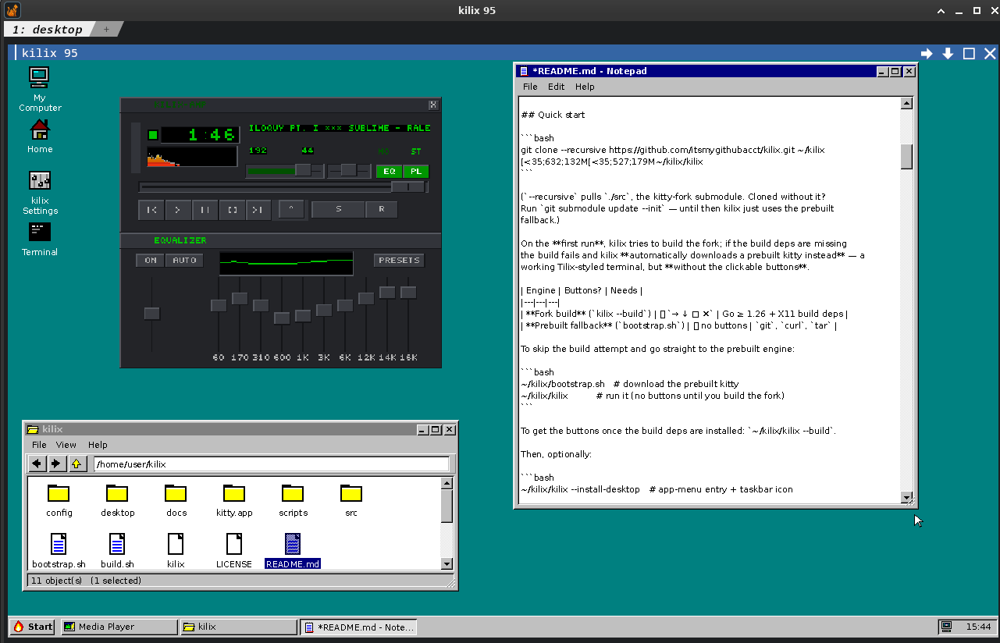
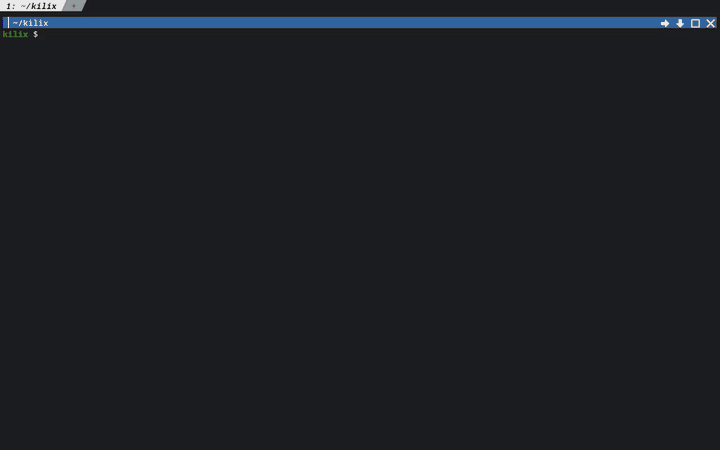

# Desktops in a tab

```bash
kilix desktop                # open the configured provider (Kilix 95 by default)
kilix xp                     # open Kilix 95 with the XP flavor
kilix desktop xp             # equivalent provider-specific form
kilix cap                    # open the optional Kilix Cap mansion
kilix tui                    # open the optional text-native desktop
kilix land                   # open the optional walkable desktop
KILIX_DESKTOP_PROVIDER=cap kilix desktop
KILIX_DESKTOP_PROVIDER=tui kilix desktop
KILIX_DESKTOP_PROVIDER=land kilix desktop
```

`kilix desktop` is a provider facade. The separate `kilix-95`
repository is the authoritative desktop. `auto` prefers an installed external
checkout; the bundled `desktop/` tree is an explicitly reported compatibility
fallback. Both must pass the same provider API, Kilix SDK, and security-feature
contract before execution. `cap` selects the native Kilix Cap executable,
`tui` selects Kilix TUI, and `land` selects Kilix Land. Managed first installs
use immutable Kilix-owned pins, and the launchers validate executable paths
rather than a Python provider manifest. The generic `command` provider remains
available for other full desktops. `kilix status` shows the effective provider
and path.

These commands open a desktop in a Kilix tab. Making XP the Pleb login desktop
also requires the session switch and provider in Pleb’s persistent
`~/.local/gpu_terminal/pleb/config/session.env`:

```sh
PLEB_DESKTOP=1
KILIX_DESKTOP_PROVIDER=xp
```

`KILIX_DESKTOP_FLAVOR=xp` alone only selects Kilix 95’s first-run appearance;
it does not turn a plain Pleb shell session into a desktop session.

```bash
KILIX_DESKTOP_PROVIDER=external \
KILIX95_AUTO_INSTALL=1 \
KILIX95_DIR=~/.local/gpu_terminal/sources/kilix-desktops/kilix-95 \
kilix desktop
```

By default the checkout is discovered under
`~/.local/gpu_terminal/sources/kilix-desktops/kilix-95`, while its writable XP desktop state (including its
wallpaper selection) stays under `~/.local/gpu_terminal/kilix-95`. The bundled
fallback keeps independent state under `~/.local/gpu_terminal/kilix`.

Relevant knobs:
`KILIX_DESKTOP_PROVIDER=auto|builtin|external|xp|cap|tui|land|command|none`,
`KILIX_DESKTOP_COMMAND`, `KILIX_DESKTOP_NAME`,
`KILIX_DESKTOP_FLAVOR=95|xp`, `KILIX95_DIR`, `KILIX95_REPO`,
`KILIX95_BRANCH`, `KILIX95_REF`, and `KILIX95_AUTO_INSTALL=1` to allow a
missing external checkout to be cloned. Automatic installs require
`KILIX95_REF` to be a full immutable commit SHA; mutable tags/branches require
the explicit `KILIX95_ALLOW_MUTABLE_REF=1` trust override. `kilix update`
similarly honors `KILIX_REF` by fetching it from the validated origin and
checking out the resolved commit detached. The updater moves the parent first,
initializes the resulting recursive submodule graph, and leaves repository-local
submodule recursion enabled so a coordinating outer checkout/reset also rolls
back changed and newly introduced nested modules.
Direct updates and fork builds serialize on the private
`~/.local/gpu_terminal/kilix/state/build-update.lock`. An outer installer that
already holds this lock must pass its open, locked descriptor to Kilix as
`KILIX_TRANSACTION_LOCK_FD` (and preserve that descriptor across `exec`);
Kilix validates that it names the canonical lock before treating it as
reentrant. The resolved path is exported to children as
`KILIX_TRANSACTION_LOCK_PATH`.

## Kilix Cap

`kilix cap` is shorthand for selecting `KILIX_DESKTOP_PROVIDER=cap`. On its
first launch, Kilix clones an immutable Kilix-pinned commit from
`https://github.com/itsmygithubacct/kilix-cap.git` into
`~/.local/gpu_terminal/sources/kilix-desktops/kilix-cap`, builds it locally with `make`, and opens
the native executable in a new tab. Later launches reuse the checkout and
incremental build. Kilix Cap itself downloads nothing at runtime.

An existing Git checkout is moved to the resolved ref rather than rebuilt as
found: Kilix validates its `origin`, then checks out the same commit a first-use
download would land on, so a moved pin reaches machines that already have the
component instead of only fresh ones. The move is reported either way, and named
`REWOUND` when the pin is older than what is installed. A checkout with local
modifications is kept and says so; `KILIX_CAP_KEEP_EXISTING_CHECKOUT=1` keeps a
clean one deliberately, naming the ref it did not install. Override
`KILIX_CAP_DIR`, `KILIX_CAP_REPO`, or `KILIX_CAP_REF` for reviewed source;
mutable refs require `KILIX_CAP_ALLOW_MUTABLE_REF=1`. Set
`KILIX_CAP_AUTO_INSTALL=0` to forbid the first-use clone or
`KILIX_CAP_TRUST_EXISTING_CHECKOUT=1` only for a trusted packaged/nonstandard
checkout. Building requires a C11 compiler, `make`, pthreads, and zlib
development headers.

The same rule holds for every component installer of this shape —
`kilix-tui-utils`, Kilix Land, Kilix IceWM, and `kilix-chawan` — each with its own
`*_KEEP_EXISTING_CHECKOUT` opt-out.

## Kilix TUI

`kilix tui` and `kilix desktop tui` select
`KILIX_DESKTOP_PROVIDER=tui`. If no installed `kilix-tui` command exists,
Kilix clones its immutable pinned `kilix-tui-utils` commit into
`~/.local/gpu_terminal/sources/kilix-desktops/kilix-tui-utils`, runs that repository’s installer,
and opens its text-native desktop. The same interface renders as terminal cells
everywhere and as a graphical Tango desktop when Kitty graphics are available.

Ordinary TUI launches pass the actual host application root and ignore inherited
`KILIX_CONTENT_ROOT`. An embedding desktop with a separate store uses
`kilix tui --content-root /absolute/apps` (also `kilix kilix-tui`). Put this option
immediately after the alias, at most once; subsequent arguments go to the TUI.
The existing root helper validates and lexically normalizes the path before
any writable setup. Invalid, repeated or misplaced selectors refuse. A remote
tab relaunch carries the explicit selector in argv again, preserving the same
authority even when the terminal server has a different environment. The TUI
receives it as `KILIX_CONTENT_ROOT` for catalog lookup,
explicit Amp setup and owned playback. For a directly installed `kilix-tui`
executable, the embedding caller instead sets that environment variable itself.
An explicit root request bypasses existing-window focus so that the selected
root and arguments are delivered. A foreground pathname cannot prove
that it belongs to that request. Ordinary launches retain existing-window focus.
The host fallback's argv must carry `--content-root`; setting the environment
alone selects the ordinary host root when the fallback runs.

Override `KILIX_TUI_UTILS_DIR`, `KILIX_TUI_UTILS_REPO`, or
`KILIX_TUI_UTILS_REF` for reviewed source. Set
`KILIX_TUI_UTILS_AUTO_INSTALL=0` to forbid a first-use clone; mutable refs and
nonstandard existing checkouts require the corresponding explicit trust
overrides.

## Kilix Land

`kilix land` and `kilix desktop land` select
`KILIX_DESKTOP_PROVIDER=land`. On first use Kilix clones its immutable pinned
`kilix-land-desktop` commit into
`~/.local/gpu_terminal/sources/kilix-desktops/kilix-land-desktop`, initializes the pinned
submodules, builds it locally with `make`, and opens the native executable.
Later launches reuse and rebuild the checkout without resetting local
development changes.

Override `KILIX_LAND_DESKTOP_DIR`, `KILIX_LAND_DESKTOP_REPO`, or
`KILIX_LAND_DESKTOP_REF` for reviewed source. Set
`KILIX_LAND_DESKTOP_AUTO_INSTALL=0` to forbid a first-use clone; mutable refs
and nonstandard existing checkouts require the corresponding explicit trust
overrides. `KILIX_LAND_DESKTOP_ASSETS` selects the runtime asset root.

## Kilix IceWM

`kilix icewm` and `kilix desktop icewm` select
`KILIX_DESKTOP_PROVIDER=icewm`. On first use Kilix clones its immutable pinned
`kilix-icewm` provider into
`~/.local/gpu_terminal/sources/kilix-desktops/kilix-icewm`. The provider then
builds its own pinned IceWM source only when no usable session binary exists.
Both layers verify immutable commits: Kilix advances a clean provider checkout
to its resolved ref, and the provider reconciles its IceWM submodule to the
recorded gitlink before building it.

Override `KILIX_ICEWM_DIR`, `KILIX_ICEWM_REPO`, or `KILIX_ICEWM_REF` for
reviewed source. Set `KILIX_ICEWM_AUTO_INSTALL=0` to forbid a first-use clone;
`KILIX_ICEWM_KEEP_EXISTING_CHECKOUT=1` deliberately keeps a development tree,
while mutable refs and nonstandard checkouts require their corresponding trust
overrides.

## Kilix 95





A full little desktop environment rendered as pixels in a kilix pane (same
graphics path as `browse`/`run`): teal wallpaper, desktop icons, overlapping
draggable/resizable windows, a start bar with a Start menu and clock, and a
right-click menu everywhere. Built in:

- **File Manager** — browse, open, rename, delete, new folder/file,
  properties, "open terminal here".
- **kilix Settings** — edits this user's private `kitty.conf`, `kilix.env`, and
  shared `~/.local/gpu_terminal/settings.conf` (GUI tabs for terminal, top-bar
  widgets, pane buttons, game availability, desktop, app, storage and
  build/update knobs, plus a raw `kitty.conf` editor). `kitty.conf` changes apply
  **live** via remote control (fallback: SIGUSR1); `kilix.env` changes are used
  by new launches.
- **Notepad** and an **image viewer**.
- **Kilix Temps** — Start ▸ Programs ▸ Kilix Temps prefers an installed
  `kilix-temps`, then the sibling `kilix-tui-utils/tools/temps` source. On a
  fresh checkout it delegates to `kilix temps`, which installs the single
  pinned `kilix-tui-utils` checkout and opens its graphical tab.
- **Kilix Memory** — Start ▸ Programs ▸ Kilix Memory opens the graphical
  RAM/swap/pressure dashboard from that same unified checkout. Its optional
  graphics dependencies are shared with Temps rather than cloned into a second
  installer-owned source cache. The same monitor is available from the Kilix
  Settings TUI Tools section.
- **PTY Sessions** — Start ▸ Programs ▸ PTY Sessions opens the graphical
  persistent-pane manager with status, read-only previews, archived journals,
  attachment and confirmed identity-bound termination. Tools retains the
  **PTY Sessions (Terminal)** manager in an unbrokered tab.
- **Games** — Start ▸ Programs ▸ Games. Each entry plays immediately if
  `~/.local/gpu_terminal/kilix-95/config/games.conf` already points at a working install, otherwise
  one consented click sets it up (paths saved to that file) and launches it in
  a tab: **Doom** downloads the official shareware episode plus a
  dosbox-staging build if no dosbox is installed (fullscreen, fire on Space,
  sound on); **Bashed Earth** clones + builds
  [itsmygithubacct/bashed-earth](https://github.com/itsmygithubacct/bashed-earth).
  Native catalog games include **Pleb Tower**, **Kilix Lights**, and **Super Kilix**, which are
  cloned recursively, built, and launched directly in their Kilix tabs.
  Play Pleb Tower from this menu, the TUI's Programs ▸ Games list, or
  `kilix games play pleb-tower`. Its two campaigns span Maple Loop and Rail Yard.
  The Games tab, `kilix settings`, and `kilix games enable|disable NAME...`
  all select which entries appear, using the root-level shared settings file.
- **Media Player** — Start ▸ Programs ▸ Media Player. The skin sits *directly
  on the desktop* with no kilix window frame (Winamp-on-Win95 style): an SDL2
  app on a private display whose background is chroma-keyed away, so only the
  skin composites onto the desktop — drag it by its own titlebar; clicks on the
  gaps fall through to the desktop icons. First run clones + builds
  [itsmygithubacct/kilix-amp](https://github.com/itsmygithubacct/kilix-amp),
  a Winamp 2.x clone, into `~/.local/gpu_terminal/kilix-95/data/apps`. The same
  binary also runs `--headless`, serving a control socket that the TUI Music
  tool drives — one decoder behind both front ends rather than two that drift.
  `kilix amp` uses the same catalog pin: it builds the
  pinned player if needed and runs it, `kilix amp --headless` runs the backend
  with no windows, and `kilix amp --install-only` just builds it (what `pleb
  install` uses to get it in place before anyone asks). The commit comes from
  the pinned content catalog, so moving that pin rebuilds on the next call.
  CLI and bundled-desktop installs use the host's `data/desktop-apps` root;
  Kilix 95 keeps its own `data/apps` store. Each launch passes its actual
  installer root as `KILIX_CONTENT_ROOT`, overriding a stale inherited value.
  Private XDG application state remains separate from model/receipt storage.
  Catalog app and remote multiplexer launches also pass the host's normalized
  content root, including relocated Kilix storage paths.
  Music can query `scripts/install-kilix-amp.py --resolve` for read-only JSON
  carrying the actual catalog executable and root. Embedding consumers pass
  `--content-root /absolute/apps` explicitly to both that query and `--json`
  setup; ordinary `kilix amp` commands continue to derive their own host root
  and ignore stale inherited `KILIX_CONTENT_ROOT`. The query does not create a
  root or build an app. Owned query/setup supervision reaps separate build
  sessions on cancellation, deadline or caller loss. This supplies no model
  receipt, license acceptance or implicit system/native dependency setup.
- **PDF Viewer** — `kilix pdf-view DOCUMENT.pdf` installs the catalog-pinned
  [kilix-pdf](https://github.com/itsmygithubacct/kilix-pdf) viewer and opens the
  document in the current terminal. Poppler/Cairo provides complete CPU
  rasterization; Kilix retains and scrolls the presented frame on the GPU when
  available, and automatically uses CPU/full-frame presentation otherwise.
  The Kilix 95 file manager associates `.pdf` files with this viewer, while a
  pathless launcher opens a PDF chooser through Evince. Use `--install-only`
  for image provisioning or `--print-ref` to inspect the immutable source pin.
- **PDF Conversion** — `kilix pdf` or `kilix pdf-convert` installs the
  catalog-pinned
  [kilix-pdf-conversion](https://github.com/itsmygithubacct/kilix-pdf-conversion)
  provider into Kilix's private app directory, then opens its guided terminal
  interface. Pass a PDF to convert it directly, use
  `--install-only` while provisioning, or `--print-ref` to inspect the exact
  immutable source commit. Its managed runtime is synchronized from the frozen
  `uv.lock` with `uv`. `kilix app run kilix-pdf-conversion` is the shared
  in-place/pane contract; `kilix app window kilix-pdf-conversion` wraps the
  terminal UI in an `xterm` PTY for IceWM and Kilix 95/XPane. The TUI, Cap,
  and Land launch the same ID in a Kilix tab, so every surface uses one pin,
  installer, executable, and launch-mode declaration.
- **Create Launcher…** (Start menu or right-click the desktop) writes
  freedesktop-style `.desktop` files into the desktop folder
  (`~/.local/gpu_terminal/kilix-95/data/desktop`, override with `$KILIX_DESKTOP_DIR`); plain
  files and folders dropped there show up as icons too. Launchers open in a
  new kilix tab / OS window, through `kilix run` for X11 apps, or through
  `kilix open-url` for URLs.

Quit via Start ▸ Shut Down… (or `Ctrl+Alt+Q`); the terminal underneath is
untouched. All artwork is drawn in code — no Microsoft assets are bundled.
Modules currently live in `desktop/` or an external `kilix-95` checkout. The
desktop draws its own Win95 mouse pointer (pass `--no-cursor` if you'd rather
not).
