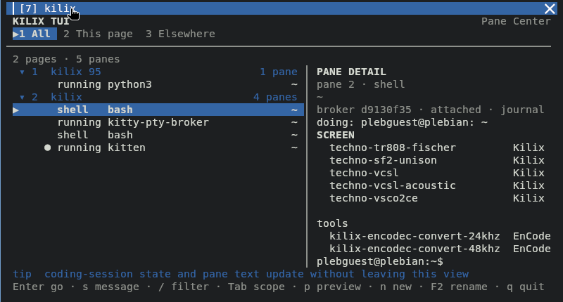

# Keybindings (Tilix layout)

| Action | Shortcut |
|---|---|
| Split right (side-by-side) | `Ctrl+Alt+R` |
| Split down (stacked) | `Ctrl+Alt+D` |
| Split (auto orientation) | `Ctrl+Shift+Enter` |
| Close pane | `Ctrl+Alt+W` |
| Focus pane ↑ ↓ ← → | `Alt+Arrows` |
| Resize pane (interactive: arrows, `Enter` keep / `Esc` cancel) | `Ctrl+Shift+R` |
| Reset pane size | `Ctrl+Shift+Home` |
| Increase / decrease terminal scale | `Ctrl+Shift+=` / `Ctrl+Shift+-` |
| Reset terminal scale | `Ctrl+Shift+Backspace` |
| Move/swap pane | `Ctrl+Alt+Arrows` |
| Zoom/maximize pane (toggle) | `Ctrl+Alt+Z` |
| Broadcast input to all panes in page | `Ctrl+Alt+B` |
| Cycle layout | `Ctrl+Alt+L` |
| Next / previous pane in page | `Ctrl+Tab` / `Ctrl+Shift+Tab` |
| New page (session) | `Ctrl+Shift+T` |
| Close page | `Ctrl+Shift+Q` |
| Next / previous page | `Ctrl+Shift+→` / `Ctrl+Shift+←`, or `Ctrl+PgDn` / `Ctrl+PgUp` |
| Scroll pane by a line | `Ctrl+Shift+↑` / `Ctrl+Shift+↓` |
| Reorder page right / left | `Ctrl+Shift+PgDn` / `Ctrl+Shift+PgUp` |
| Jump to page 1–10 | `Ctrl+Alt+1` … `Ctrl+Alt+0` |
| Page and pane switcher | `F12` |
| Rename page | `F2` |
| Content-only fullscreen (hide page strip and pane chrome) | `F11` |
| Toggle this tab's OS window fullscreen from a shell | `kilix fullscreen` |
| New OS window (same dir) | `Ctrl+Shift+N` |

## Copy and paste

The selection and paste gestures, in a plain shell and inside a full-screen TUI, are in the [README](../README.md#copy-and-paste--including-inside-full-screen-tuis).

Two things that look like failure but are not:

- **The highlight disappears.** Busy TUIs repaint constantly, and any repaint
  that touches a selected line clears the highlight. The text was copied the
  moment you released the button — paste it and it is there.
- **No text under the drag?** Open the scrollback pager (`Ctrl+Shift+H`)
  instead: nothing grabs the mouse there, so ordinary drag-select works on
  everything the pane has printed.

Scripts should not assume `xclip`/`xsel`; use `kitty +kitten clipboard`, which
talks to the terminal directly.

## Pane Center — `F12` or `kilix panes`

**Version boundary:** this host's default toolkit installer and Content package
select `af7e848`, which provides the interactive switcher. The richer CLI and
activity features described below require a later compatible toolkit. They
are not established merely by this host accepting the `panes` verb. For the
selected 0.2.2 source, use the [operation guide](help/operations/README.md),
basic `kilix ls`, `focus` and `watch`, and authenticated `kitten @` commands.



`F12` opens the **Pane Center** (`kilix-panes`, with `kilix-switch` retained as
the compatible command), from
[kilix-tui-utils](https://github.com/itsmygithubacct/kilix-tui-utils), over the
current pane. It replaces the two choosers kitty ships, which were the same
thing twice — a numbered list of titles, one for pages and one for panes. A
title is a poor handle on a pane, since several are `bash` and several more are
whatever directory they started in, so the list told you least exactly when you
had enough windows to need it.

The center shows one tree of pages and their panes with activity, coding-agent
session, process, directory, PTY-broker journal state, current task, and a live
view of what the highlighted pane is showing. `Tab` cycles between everything,
this page, and everywhere else; `Ctrl+Shift+B` `q` opens it already scoped to
this page. `/` filters, `s` sends and submits a bounded message, and it can also
rename or close what it lists; closing always asks first.

`kilix panes` with no arguments opens that TUI. Its CLI is the same data model,
intended for agents and scripts:

```sh
kilix panes list
kilix panes --json
kilix panes dump PANE --lines 40
kilix panes wait PANE --for idle --timeout 300
kilix panes send PANE --enter 'continue'
```

Codex `idle` is conservative: the live process must still own its rollout and
the newest explicit turn boundary must be `task_complete`; `task_started` is
`working`, and missing evidence stays `agent`. Targets accept pane IDs, unique
labels, or broker/coding-session prefixes and reject ambiguity. Messages use
the exact per-pane broker-session match and the existing 1024-byte authorizer;
an accepted send is still fire-and-forget, so use `dump` to verify delivery
when it matters.

It reaches the terminal through the same scoped remote-control credential every
Kilix pane already holds — the one behind `kilix ls`, `kilix focus` and
`kilix watch` — so it can do exactly what those commands can and nothing more.
If the tool is not installed, `F12` says so rather than opening an overlay that
disappears.

## tmux-style leader — `Ctrl+Shift+B`

If tmux is already in your fingers, press `Ctrl+Shift+B` and then a tmux key.
Panes are tmux panes, pages are tmux windows. One key per press and the mode
exits, just like after a tmux prefix; an unrecognized key beeps and exits, and
`Esc` leaves early.

The leader is **not** tmux's own `Ctrl+B`, on purpose: `kilix serve` / `attach` /
`view` run a real tmux server whose prefix has to reach it untouched, and
`Ctrl+B` is readline's backward-char in every shell. `Ctrl+Shift+B` keeps the
muscle memory while leaving both alone.

| tmux | kilix | Action |
|---|---|---|
| `C-b ← ↑ ↓ →` | `Ctrl+Shift+B` then `← ↑ ↓ →` | Focus pane in that direction |
| `C-b o` | `Ctrl+Shift+B` `o` | Next pane |
| `C-b ;` | `Ctrl+Shift+B` `;` | Last (previously focused) pane |
| `C-b q` | `Ctrl+Shift+B` `q` | The switcher, scoped to this page |
| `C-b z` | `Ctrl+Shift+B` `z` | Zoom/maximize pane |
| `C-b x` | `Ctrl+Shift+B` `x` | Close pane |
| `C-b { }` | `Ctrl+Shift+B` `{` / `}` | Swap pane back / forward |
| `C-b Space` | `Ctrl+Shift+B` `Space` | Next layout |
| `C-b C-←→` | `Ctrl+Shift+B` `r` | Resize pane interactively |
| `C-b " %` | `Ctrl+Shift+B` `"` / `%` | Split stacked / side-by-side |
| `C-b c` | `Ctrl+Shift+B` `c` | New page |
| `C-b n` / `p` | `Ctrl+Shift+B` `n` / `p` | Next / previous page |
| `C-b l` | `Ctrl+Shift+B` `l` | Last (previously used) page |
| `C-b 1`…`9` | `Ctrl+Shift+B` `1`…`9` | Jump to page N |
| `C-b w` | `Ctrl+Shift+B` `w` | Page chooser |
| `C-b ,` | `Ctrl+Shift+B` `,` | Rename page |
| `C-b &` | `Ctrl+Shift+B` `&` | Close page |
