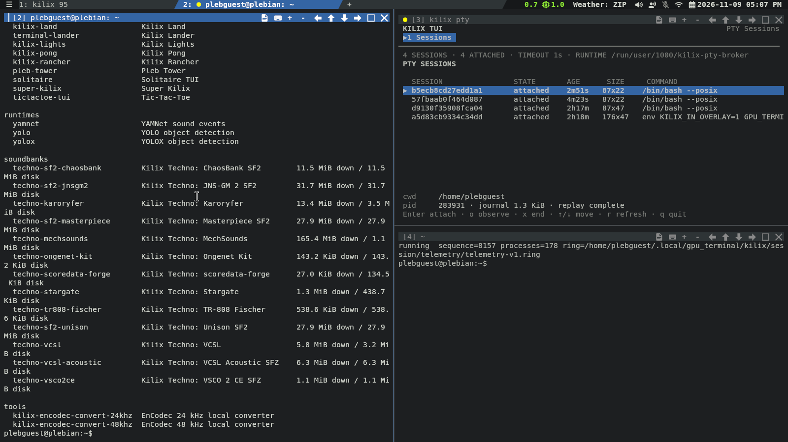

# kilix — kitty that looks & behaves like Tilix, with clickable pane buttons

This page keeps the README's original introduction, the video episodes and the full feature list. The [README](../README.md) is now a short index into these documents.

`kilix` is a self-contained wrapper around a **fork of kitty** that gives
each pane's title bar clickable **keyboard, `+ - ← ↑ ↓ → ▢ ✕` buttons** —
synchronized input, local text size, four-way splits, maximize, and close —
just like Tilix's pane headers, on top of kitty's GPU-rendered speed. For Tilix
users who want kitty underneath, and anyone who wants clickable pane chrome on
kitty.

Native Windows and Linux development share this repository.
See [Windows builds and WSL support](../windows/README.md) for build instructions,
preview downloads, and platform limitations.

It runs its own kitty binary with its own config and icon, so it leaves any
kitty you already have completely untouched. Tracked defaults stay in
`config/`; every Kilix-owned writable file lives below
`~/.local/gpu_terminal/kilix`. Stack-wide chrome and game-availability
preferences are the intentional exception: every GPU Terminal project reads
`~/.local/gpu_terminal/settings.conf`.

The default layout is `config/` for user settings, `state/` for persistent
state, `cache/` for regenerable data, `session/` for sockets and frame files,
`data/` for optional downloads, `build/` for compiled fork generations, and
`prebuilt/` for the fallback kitty bundle. `KILIX_STORAGE_HOME` relocates the
complete tree. Freedesktop launchers/icons are the intentional exception:
`--install-desktop` uses the standard XDG application paths, and records what
it wrote in `state/` so `--uninstall-desktop` can take exactly that back out.

## Watch the episodes

**Part two — Kilix: pages, panes, and clickable chrome** (1920×1080, 3m32s,
[full file](https://github.com/itsmygithubacct/kilix/releases/download/media-v1/02-kilix-pages-panes-and-chrome.mp4)):

https://github.com/user-attachments/assets/b4d35ed1-4eb3-4184-92f3-34b50cc385bf

**Part four — How applications stay inside Kilix** (inline player is a 720p preview;
[full quality](https://github.com/itsmygithubacct/kilix/releases/download/media-v1/04-applications-inside-kilix.mp4)
is 1920×1080, 3m23s, 33 MB):

https://github.com/user-attachments/assets/4cdd423e-4958-477d-8a85-b78049c46610

Both are parts of *Kilix, Pleb, and Plebian-OS: A Desktop Built Inside a Terminal*, published as a
[media release](https://github.com/itsmygithubacct/kilix/releases/tag/media-v1) so a clone stays
small. The [full series](https://github.com/itsmygithubacct/plebian-os#watch-the-series) (31m22s)
lives on `plebian-os` and plays at [plebian-os.com](https://plebian-os.com/#watch).

## Features

- **Clickable pane buttons** keyboard, `+ - ← ↑ ↓ → ▢ ✕` — synchronized
  keyboard input, local font size, four-way split, maximize, and close controls
  that highlight on hover.
- **Crash-persistent panes** — each normal pane runs behind its own independent
  `kitty-pty-broker` process. A Kilix crash or ordinary frontend loss detaches
  the pane without killing its shell; the next Kilix process restores detached
  panes as recovered tabs. `exit` ends the session naturally, while the pane
  `✕` warns before deliberately terminating it.
- **Thermometer-in-chrome** — an optional hottest-sensor indicator opens the
  graphical Kilix Temps dashboard in a new tab. It is green below 80°C, yellow
  at 80–89°C, and red from 90°C; the shared setting defaults to off.
- **Network/Wi-Fi-in-chrome** — a network item immediately left of the calendar
  opens NetworkManager's `nmtui` in an overlay pane.
- **Battery-in-chrome** — on laptops, a green/yellow/red battery item appears at the
  far right of the page strip below full charge, including while charging, with the percentage
  shown to the left of the battery icon; click it to hide/show the percentage.
- **Date/time-in-chrome** — the page strip shows a high-contrast local date and
  time immediately to the left of the battery item. Click its calendar icon for
  a navigable month widget, or the date/time text for a live date widget.
- **Pane title menu** — click a pane's title for Tilix-style actions: rename, copy title,
  reset, clear, split right/down, close.
- **Drag-to-split by quadrant** — drag a pane's header onto another pane's edge to split it (Tilix's model).
- **Pages (Tilix sessions)** — each page is a kitty tab, with an always-on page strip and a `+` button.
  The strip holds ten pages per row: the eleventh starts a second row (up to 20),
  and so on in rows of ten. The `+` button follows the last page and never starts a row.
- **Input broadcast** — `Ctrl+Alt+B` mirrors your typing to every pane in the page
  (Tilix's "synchronize input").
- **Tilix look & keys** — per-pane title bars, active-pane highlight, dimmed inactive panes, Tango palette, Tilix keybindings.
- **Own taskbar identity** — groups separately from plain kitty, with its own icon.
- **Stream to other devices** — persist a session and attach (or watch read-only)
  from another machine, share a GUI app to a browser/VNC client, or stream the whole
  kilix — graphics and video included — to any browser. Loopback-first, opt-in.
- **kilix 95** — a Windows 95-style desktop environment in a tab (`kilix desktop`):
  start bar, launchers, file manager, and a Settings app that edits the kilix
  config live.
- **Kilix Cap** — an optional full-color mansion desktop (`kilix cap`) with
  physical app launchers, live system rooms, housekeeping, and the Kilix 95
  game catalog.
- **Kilix TUI** — an optional text-native desktop (`kilix tui`) whose
  complete control surface works over SSH, tmux, or a bare console and gains a
  graphical Tango rendering when Kitty graphics are available.
- **Kilix Land** — an optional walkable graphical desktop (`kilix land`) with
  an immutable Kilix-owned source pin and first-use native build.
- **Kilix IceWM** — a pinned IceWM desktop provider (`kilix icewm`) rendered
  through Kilix's private X application surface, with catalog apps opened as
  ordinary desktop windows.
- **Host SDK for Python desktops** — Kilix 95 and the bundled compatibility
  provider import stable helpers from `config/kilix_sdk` instead of depending
  on raw `config/browse.py` / `config/gfx.py` internals. SDK 1.2 includes shared
  content installation, authenticated private-X-application sessions, and game
  availability. SDK 1.10 adds catalog application plans for current-terminal,
  pane, and desktop-window presentation; SDK 1.12 exposes shared package and
  install identities plus named actions, accepted inputs, system commands, and
  lifecycle policy from content schema 3; SDK 1.13 adds the shared pane CPU
  visibility policy, and SDK 1.14 exposes the pinned shared telemetry client.
  Native executable, TUI, and command
  providers use the launcher’s executable/pin boundary instead.
- **Self-contained** — prefers its bundled fork build, and falls back to a prebuilt kitty if you haven't built it.
