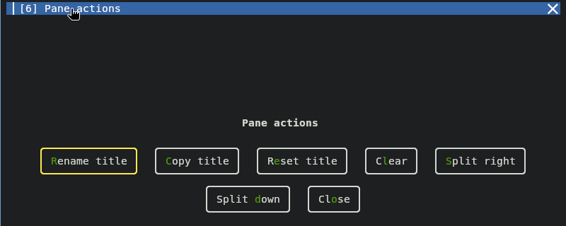

# Clickable buttons (the headline feature)

Every pane's title bar shows these synchronized-input/font/split/maximize/close
buttons on the right (bold):

| Button | Click does | Same as |
|---|---|---|
| CPU/RAM chip | open Kilix Memory; CPU is left, pane RAM is right | `kilix memory --graphics` |
| keyboard | join/leave the pane's synchronized-input group | Tilix input synchronization |
| `+` | increase font size for this Kilix window | `change_font_size current +2.0` |
| `-` | decrease font size for this Kilix window | `change_font_size current -2.0` |
| `←` | split left — new pane to the left | split right, then swap |
| `↑` | split up — new pane above | split down, then swap |
| `↓` | split down — new pane below | `Ctrl+Alt+D` |
| `→` | split right — new pane to the right | `Ctrl+Alt+R` |
| `▢` | maximize / zoom the pane | `Ctrl+Alt+Z` |
| `✕` | close the pane | `Ctrl+Alt+W` |

The buttons are drawn as text or **Nerd Font icons** — pane CPU, a shared chip,
and pane RAM,
a keyboard for synchronized input, `+`/`-` for local font size, bold arrows for splits
(pointing where the new pane lands), a maximize glyph, and a close ✕. They
**highlight under the cursor**. A single keyboard click toggles that pane; its
button stays depressed while selected, and typing in any selected pane reaches
all other selected panes. Double-click the keyboard to select every pane in
the tab; double-click it again to deselect every pane. App overlays are never
included. Hiding the keyboard button in Settings also clears active
synchronized-input groups. Clicking a header focuses the pane, and a click on
the title itself opens the **pane action menu** — rename, copy title, reset,
clear, split right/down, close (maximize also lives on the `▢` button and
`Ctrl+Alt+Z`).
The active pane's header is highlighted (bright blue); inactive panes are grayed —
matching Tilix's active-pane cue.

Both resource sides are enabled in `auto` mode by default. The CPU value is
the sampled use of the pane's shell and descendant processes in logical-core
equivalents, and appears to the left of the chip above `1.0`; set shared
`KILIX_CHROME_PANE_CPU_MODE` to `always` to retain it at lower use, or `off`
to hide it. Pane memory appears to the right when the pane's shell and
descendant processes reach 1 GiB, shows GiB to one decimal place (`1.1`), and
grows from a square chip toward a RAM-stick shape as the number gains digits.
Set `KILIX_CHROME_PANE_MEMORY_MODE` to `always` to report smaller values in
MiB/KiB, or `off` to hide that side. The chip remains whenever either side is
visible, and clicking it opens Kilix Memory in a new tab. The memory sampler
uses proportional values from Linux `smaps_rollup` where readable and RSS as a
fallback. A single `kilix-telemetry` sampler publishes both aggregates to a
private mmap ring; title bars refresh only when a displayed value changes and
retain local process-tree fallbacks if the shared service is unavailable.

When a pane's processes hold more than 512 MiB of GPU memory, a pale-blue GPU chip
shows that amount right of the RAM measurement (NVML per-process memory for
NVIDIA, DRM fdinfo for AMD and Intel). Set `KILIX_CHROME_PANE_GPU_MODE` to
`always` or `off`; the 512 MiB threshold is fixed. Attribution is by process:
memory a service holds outside every pane (a model server, for example) is in
the top-bar total but in no pane chip, and a pane running only a client of
that service has no GPU chip.

The far right of the page strip can show system CPU and RAM, thermometer,
volume, network, calendar, local date/time, and (when applicable) battery
items. System CPU and RAM come first and are shown at all times by default, in
the same form as a pane's resource chip: whole-system CPU use in logical-core
equivalents to the left of the chip and RAM in use (total minus available) in
GiB to its right, for example `6.4 󰍛 12.3`. Clicking it opens Kilix Memory and
right-clicking it opens Kilix Settings.
Set shared `KILIX_CHROME_SYSTEM_LOAD_MODE` to `auto` to apply the pane
thresholds (CPU above `1.0`, RAM at 1 GiB or more), or `off` to hide it.
Total GPU use sits immediately right of it in the same form: percent busy left
of a graphics-card glyph and VRAM in use right of it, for example `37% 󰢮 2.2`.
With several GPUs the discrete one is shown and a click lists each GPU; it is
hidden when no GPU is readable, and a runtime-suspended GPU reads `sleep`
and is not read. An idle GPU with runtime power management has its counters read at most
every 30 s (twice its autosuspend delay when longer, up to 120 s) so that it
can sleep; readouts can lag or miss short bursts. New pane processes may have
DRM fdinfo read once during that backoff. If any NVIDIA GPU is asleep or in
backoff, NVML stays closed for all of them. An awake GPU left unread shows
`held` above its idle or sleeping NVIDIA sibling (also in auto mode), with its pane memory unavailable
until sampling resumes. The click card has a separate sampler and may take
an initial reading during the bar's backoff. NVIDIA is read through NVML (`libnvidia-ml.so.1`), AMD
through sysfs; nothing is spawned. Set shared `KILIX_CHROME_SYSTEM_GPU_MODE`
to `auto` (10% busy or more than 512 MiB) or `off`. The
thermometer is disabled by default; when enabled it shows the hottest readable Linux
thermal-zone/hwmon temperature to one decimal place in green below 80°C, yellow
at 80–89°C, or red from 90°C. It sits immediately right of the system CPU and
RAM readout (at the left edge of the status group when that is off) and
opens a compact status card on one click and `kilix-temps --graphics` on a
double-click. A neutral `--°` remains clickable when no sensor can be read.
The volume icon opens a compact slider on one click, the full clickable
`kilix-volume` output selector on a double-click, and a settings card with a
live Mute checkbox on right-click. It sits to the left of the network/Wi-Fi
icon, which shows compact connection status on one click and opens `nmtui` on
a double-click. Click the calendar icon for a navigable month widget, or click
the date/time text for a live local-date, clock, and timezone widget.
On laptops, a battery status item appears to its right below full charge,
including while charging or connected to AC. It hides when all present laptop
batteries have valid 100% readings; unreadable charge remains visible as `?%`.
It is green above 50%, yellow at 50% and below, red at 20% and below, and
shows the percentage to the left of the battery icon. One click shows battery
details and a double-click toggles the percentage on/off. Right-clicking the
non-volume widgets opens Kilix Settings. Use `kilix settings` or Start ▸ Settings ▸ Top bar / Pane
buttons in Kilix 95 to remove and re-add every status item and title-bar button.
Both interfaces update the single non-executable source of truth at
`~/.local/gpu_terminal/settings.conf` (override with
`GPU_TERMINAL_SETTINGS_FILE`); the GUI also edits `KILIX_CHROME_CLOCK_FORMAT`.

**Drag-to-split by quadrant** (Tilix's model): drag a pane by its title bar onto another
pane and drop on that pane's **top / bottom / left / right** triangle — a live half-pane
preview shows where it lands, and the target splits 50/50 in that direction (near side =
before, far side = after). Quadrants are bounded by the pane's true diagonals; dropping
on a maximized/stacked pane is rejected.

The buttons only exist in the **fork build** — the prebuilt fallback is a plain
(Tilix-themed) kitty with no buttons. See [Development](development.md#development) for how the fork works.
